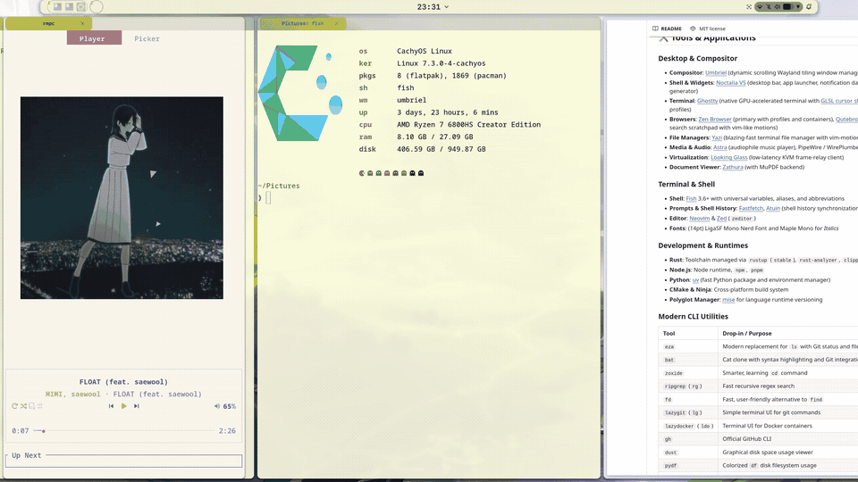
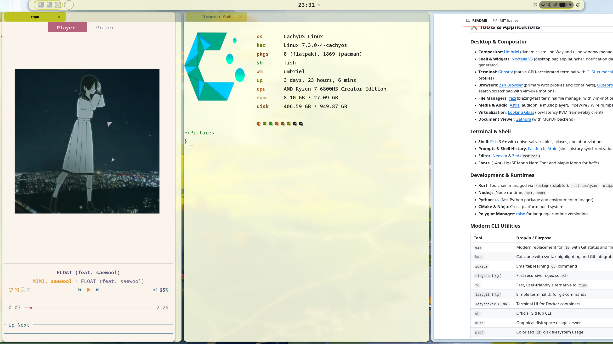
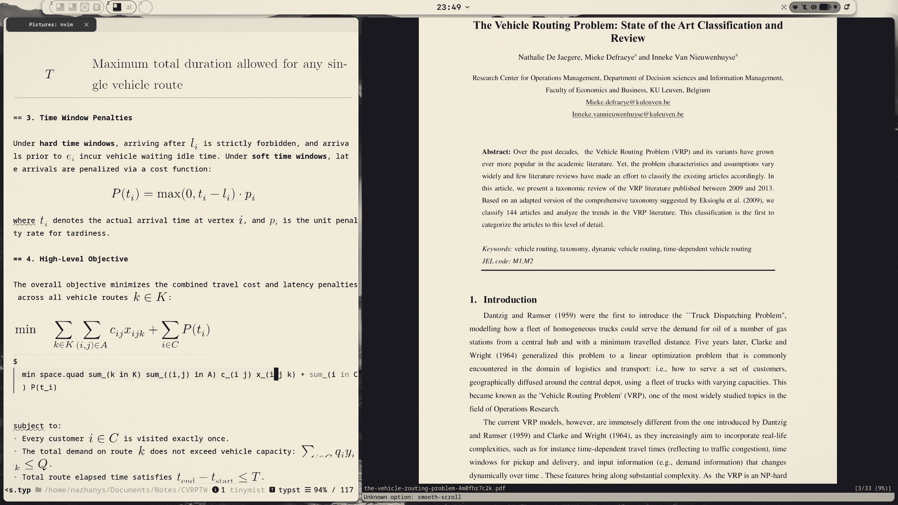
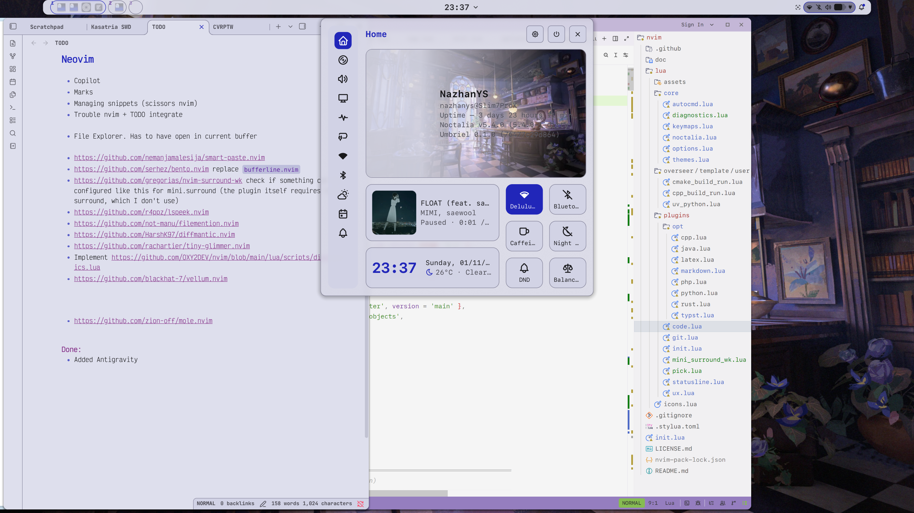
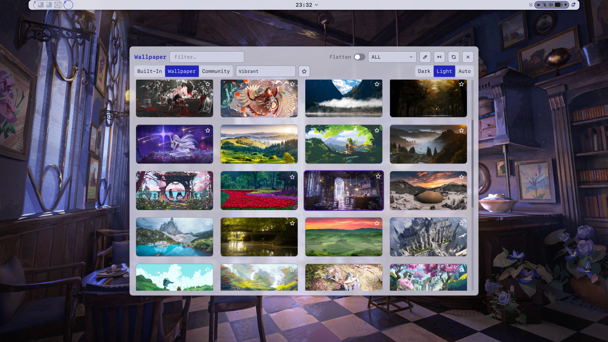

# 🌌 Dotfiles

> Personal dotfiles managed with [chezmoi](https://www.chezmoi.io/) for **Arch Linux / CachyOS** (with **Limine** snapshots), built around the **Umbriel** Wayland compositor and **Noctalia** shell.

---

## 📑 Table of Contents

- [Overview](#-overview)
- [Showcase & Screenshots](#-showcase--screenshots)
- [Tools & Applications](#-tools--applications)
  - [Desktop & Compositor](#desktop--compositor)
  - [Terminal & Shell](#terminal--shell)
  - [Development & Runtimes](#development--runtimes)
  - [Modern CLI Utilities](#modern-cli-utilities)
  - [Custom Scripts & Daemons](#custom-scripts--daemons)
- [Repository Structure](#-repository-structure)
- [Installation & Setup](#-installation--setup)
- [Services Setup](#-services-setup)
- [Keybind Highlights](#-keybind-highlights)
- [Chezmoi Workflow](#-chezmoi-workflow)

---

## 🔭 Overview

This repository holds my desktop configs, shell setup, helper scripts, and systemd user services:

- **Reproducible Bootstrap**: Automated setup on fresh Arch / CachyOS installs via [`bootstrap.sh`](bootstrap.sh).
- **Clean Separation**: Tracked dotfiles are deployed by Chezmoi, while repo scripts, screenshots, caches, and runtime databases are excluded via [`.chezmoiignore`](.chezmoiignore) and [`.gitignore`](.gitignore).
- **Dynamic Theming**: Noctalia V5 generates matching Material 3 palettes across Umbriel, Ghostty, Obsidian, Yazi, Zathura, Zen, and my [Neovim config](https://github.com/nadvent/neovim-conf).
- **Ergonomic Keyboard Layers**: Kanata provides CapsLock-triggered vim navigation, modifier, and symbol layers at boot.
- **GPU Passthrough VM**: Near bare-metal Windows VM with [GPU passthrough and Looking Glass](https://gist.github.com/safwyls/96b6cf4b49e04af2668b7a77502e5ff2)—toggle IOMMU/PCI IDs in `/etc/default/limine`, regenerate boot entries, and reboot.

### 📸 Showcase & Screenshots



| 🌌 Desktop Overview & RMPC Player (`rmpc` + `Ghostty`) |  📖 E-Ink Reading Mode Shader (`Umbriel` + `Zathura`)   |
| :----------------------------------------------------: | :-----------------------------------------------------: |
| [](pictures/01.png)  |   [](pictures/02.png)   |
| **⚡ Control Center & Notes Scratchpad (`Obsidian`)**  |    **🎨 Noctalia Wallpaper & Dynamic Theme Engine**     |
| [](pictures/03.png)  | [](pictures/04.png) |

> **Setup Highlights:**
>
> - **01 · Daily Driver & Music**: Ghostty running the vertical `rmpc` scratchpad (album art, live waveform seekbar, visual playlist/album minipicker), fastfetch, and Zen Browser styled with Noctalia's M3 palette.
> - **02 · E-Ink Reading Shader**: Custom [`reading_mode.glsl`](dot_config/umbriel/reading_mode.glsl) post-processing shader renders a textured e-ink paper look with Bayer dithering for long reading sessions.
> - **03 · Persistent Scratchpads**: Global toggleable scratchpads across workspaces for Qutebrowser quick search, Obsidian notes, `rmpc` music player, and a floating terminal.
> - **04 · Instant Theming**: Noctalia's wallpaper picker (`Mod+Shift+W`) dynamically updates color palettes across the compositor, terminal, editor, and desktop widgets.

---

## 🛠️ Tools & Applications

### Desktop & Compositor

- **Compositor**: [Umbriel](https://docs.noctalia.dev/umbriel/) (scrolling/master/dwindle Wayland compositor with scratchpads, blur, and HDR)
- **Compositor Shaders**: Custom GLSL shaders including [`reading_mode.glsl`](dot_config/umbriel/reading_mode.glsl) and cursor trails
- **Shell & Widgets**: [Noctalia V5](https://docs.noctalia.dev/) (bar, launcher, notifications, control center, M3 palette engine)
- **Terminal**: [Ghostty](https://ghostty.org/) (GPU-accelerated terminal with [GLSL cursor shaders](https://github.com/sahaj-b/cursor-shaders) and dynamic tab theming)
- **Browsers**: [Zen Browser](https://zen-browser.app/) (primary) and [Qutebrowser](https://qutebrowser.org/) (floating vim-driven quick-search scratchpad)
- **File Manager**: [Yazi](https://yazi-rs.github.io/) (terminal file manager with custom `smart-delete.yazi` plugin and D-Bus `FileManager1` integration)
- **Music & Audio**: [rmpc](https://github.com/mierak/rmpc) (custom vertical scratchpad, playlist/album minipicker, and waveform daemon), [MPD](https://www.musicpd.org/) ([`mpd.conf`](dot_config/mpd/mpd.conf) over PipeWire with `mpd-mpris`), PipeWire / WirePlumber
- **Virtualization**: [Looking Glass](https://looking-glass.io/) (low-latency KVM frame-relay client)
- **Document Viewer**: [Zathura](https://pwmt.org/projects/zathura/) (MuPDF backend)

### Terminal & Shell

- **Shell**: [Fish](https://fishshell.com/) with universal variables, aliases, and abbreviations
- **Telemetry & History**: [Fastfetch](https://github.com/fastfetch-cli/fastfetch) and [Atuin](https://atuin.sh/)
- **Editors**: [Neovim](https://github.com/nadvent/neovim-conf) & [Zed](https://zed.dev/)
- **Fonts**: LigaSF Mono Nerd Font (13pt), Maple Mono for italics, and Monaspace Xenon for math

### Development & Runtimes

- **Rust**: `rustup` (`stable`), `rust-analyzer`, `clippy`, `cargo-binstall`
- **Node.js**: Node, `npm`, `pnpm`
- **Python**: [uv](https://astral.sh/uv)
- **Build & Version Management**: CMake, Ninja, and [mise](https://mise.jdx.dev/)

### Modern CLI Utilities

| Tool | Purpose |
| :--- | :--- |
| `eza` | Modern `ls` replacement with Git status and icons |
| `bat` | `cat` replacement with syntax highlighting |
| `zoxide` | Smarter directory jumping (`cd`) |
| `ripgrep` (`rg`) | Fast recursive regex search |
| `fd` | Fast, friendly `find` alternative |
| `lazygit` (`lg`) | Terminal UI for Git |
| `lazydocker` (`ldo`) | Terminal UI for Docker |
| `gh` | GitHub CLI |
| `dust` / `pydf` | Disk usage and filesystem viewers |
| `wl-clipboard` | Wayland clipboard utilities (`wl-copy`, `wl-paste`) |

### Custom Scripts & Daemons

Tracked in `dot_local/bin/` and `dot_config/rmpc/`:

- `escape-scratchpad`: Dismisses any currently visible scratchpads in Umbriel.
- `ghostty-scratchpad` / `qutebrowser-scratchpad`: Floating terminal and quick-search scratchpad launchers.
- `sync-ghostty-tab-theme`: Syncs Ghostty tab and GTK CSS styling to Noctalia's active color palette.
- `toggle-reading-mode.sh`: Toggles the e-ink paper screen shader in Umbriel.
- `umbriel-layout-notify`: Sends live notifications when switching Umbriel tiling layouts.
- `toggle-audio.sh`: Switches output between desktop speakers and Behringer UMC204HD.
- `lg_vm.sh`: Watches `/dev/shm/looking-glass` to auto-launch Looking Glass when the VM starts.
- `yazi-filemanager1`: Python D-Bus daemon implementing `org.freedesktop.FileManager1` so browsers open folders in Yazi.
- `rmpc` suite (`dot_config/rmpc/`): `launch_rmpc.sh` (scratchpad launcher with dedicated `ghostty.conf`), `playlist_picker.sh`, `fav_toggle.sh`, and the native `rmpc-picker` source (`dot_config/rmpc/picker/`) powering both visual playlist/album search and the `rmpc-waveform.service` daemon.

---

## 📂 Repository Structure

```text
~/.local/share/chezmoi/
├── .chezmoiignore
├── .gitignore
├── README.md
├── bootstrap.sh
├── pictures/
├── scripts/
│   ├── install-yazi-plugins.sh
│   └── manage-assets.sh
├── dot_config/
│   ├── fish/
│   ├── ghostty/
│   ├── git/
│   ├── kanata/
│   ├── mpd/
│   ├── noctalia/
│   ├── qutebrowser/
│   ├── rmpc/
│   ├── systemd/user/
│   ├── umbriel/
│   ├── yazi/
│   └── zathura/
└── dot_local/
    ├── bin/
    └── share/applications/
```

---

## 🚀 Installation & Setup

```bash
# 1. Prerequisites (Arch / CachyOS)
sudo pacman -S --needed git base-devel chezmoi

# 2. Initialize, inspect, and apply dotfiles
chezmoi init https://github.com/nadvent/dotfiles.git
chezmoi diff
chezmoi apply

# 3. Optional full system bootstrap (packages, runtimes, fonts, services)
cd ~/.local/share/chezmoi
./bootstrap.sh --dry-run
./bootstrap.sh --all
```

Selective bootstrap flags: `--cli`, `--gui`, `--rust`, `--node`, `--yazi`, `--assets`.

---

## ⚙️ Services Setup

1. **Kanata (Keyboard Remapper)** — Uses [`kanata.kbd`](dot_config/kanata/kanata.kbd) (device IDs are currently matched to my local keyboards):
   ```bash
   sudo usermod -aG input,uinput "$USER"
   echo 'KERNEL=="uinput", MODE="0660", GROUP="uinput", OPTIONS+="static_node=uinput"' | sudo tee /etc/udev/rules.d/99-input.rules
   sudo udevadm control --reload && sudo udevadm trigger
   systemctl --user enable --now kanata.service
   ```
2. **Yazi D-Bus (`FileManager1`) & RMPC Waveform Daemons**:
   ```bash
   sudo pacman -S --needed python python-gobject
   make -C ~/.config/rmpc/picker
   systemctl --user daemon-reload
   systemctl --user enable --now yazi-filemanager1.service rmpc-waveform.service umbriel-layout-notify.service
   ```

---

## ⌨️ Keybind Highlights

Selected Umbriel keybindings (full list in [`dot_config/umbriel/cfg/keybinds.toml`](dot_config/umbriel/cfg/keybinds.toml)):

| Keybinding | Action |
| :--- | :--- |
| `Mod` | Toggle Noctalia App Launcher |
| `Mod + Return` / `Mod + Space` | Toggle Terminal / Quick Search Scratchpad |
| `Mod + N` / `Mod + M` | Toggle Notes (`Obsidian`) / Music (`rmpc`) Scratchpad |
| `Mod + Escape` | Dismiss active scratchpad |
| `Mod + B` / `Mod + E` / `Mod + Shift + E` | Launch Zen Browser / Yazi / Zed |
| `Mod + Backslash` | Cycle workspace layout (`scrolling` / `master` / `dwindle`) |
| `Mod + Ctrl + R` | Toggle E-Ink Reading Mode shader |
| `Mod + F12` | Toggle Audio Output (Speakers ⟷ Behringer UMC204HD) |
| `Print` / `Shift + Print` / `Ctrl + Print` | Screenshot Region / Fullscreen / Annotate |

---

## 🔄 Chezmoi Workflow

```bash
chezmoi diff                      # Compare repo vs. $HOME
chezmoi re-add                    # Pull edited $HOME configs back into repo
chezmoi apply                     # Apply repo changes to $HOME
./scripts/manage-assets.sh status # Inspect tracked helper scripts & .desktop files
```

## 📄 License

Shared under the [MIT License](LICENSE). Feel free to adapt anything useful!
